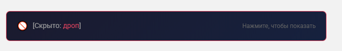
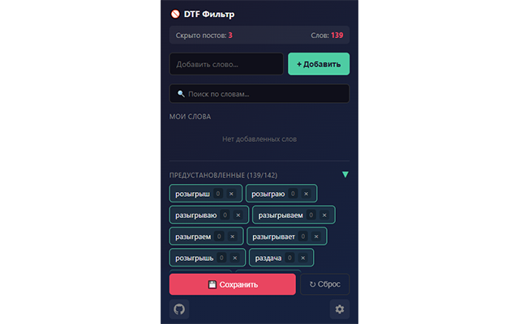

# 🚫 DTF Фильтр слов

> Chrome-расширение для автоматического скрытия постов с определенными словами на [DTF.ru](https://dtf.ru).

[](LICENSE)
[](https://github.com/jtsdtess/dtf-no-giveaways)

## Возможности

- **Автоматическая фильтрация** — посты скрываются при загрузке и при скролле (infinite scroll)
- **Визуальные теги** — управление словами через интерактивные теги с счётчиками скрытых постов
- **Поиск по словам** — фильтрация тегов в реальном времени
- **~90 предустановленных слов** — готовый список, можно отключать индивидуально
- **Кастомные слова** — добавляй свои слова для фильтрации
- **Уведомления** — тосты при скрытии постов (опционально)
- **Настройки** — модальное окно для управления опциями
- **Не удаляет посты** — скрытые посты можно развернуть кликом по плашке

## Скриншоты

| Скрытый_post                           | Popup настроек                      |
| -------------------------------------- | ----------------------------------- |
|  |  |

## Установка

1. Скачай [последний релиз](https://github.com/jtsdtess/dtf-no-giveaways/releases) или клонируй репозиторий
2. Открой `chrome://extensions/`
3. Включи **«Режим разработчика»**
4. Нажми **«Загрузить распакованное расширение»**
5. Выбери папку с расширением

## Использование

После установки расширение работает автоматически на всех страницах DTF.

**Настройка слов:**

1. Кликни на иконку расширения
2. В поле ввода введи слово и нажми Enter или «+ Добавить»
3. Для отключения пресета нажми × на зелёном теге
4. Для восстановления пресета нажми + на сером теге
5. Нажми «Сохранить» для применения изменений

**Настройки:**

- Кликни на шестерёнку для открытия меню
- Включи/выключи уведомления о скрытых постах

**Горячие клавиши:**
- `Ctrl+S` — сохранить изменения

## Структура проекта

```
dtf-filter/
├── manifest.json           # Manifest V3 конфигурация
├── icon16.png              # Иконка 16×16
├── icon48.png              # Иконка 48×48
├── icon128.png             # Иконка 128×128
├── src/
│   ├── content/
│   │   ├── content.js      # Логика фильтрации и Intersection Observer
│   │   └── presets.js      # ~90 предустановленных слов
│   └── popup/
│       ├── popup.html      # UI настроек, footer, modal
│       ├── popup.js        # Логика тегов, модального окна
│       └── popup.css       # Стили, анимации, тосты
├── assets/
│   └── screenshots/        # Скриншоты
├── PRIVACY.md              # Политика конфиденциальности
└── README.md
```

## Как это работает

1. `content.js` инжектится на страницы DTF
2. При загрузке сканируются все посты на наличие ключевых слов
3. `MutationObserver` отслеживает появление новых постов при скролле
4. `IntersectionObserver` показывает уведомление когда плашка попадает в viewport
5. Найденные посты скрываются через CSS-класс (надёжнее inline styles)

## Хранилище

**chrome.storage.sync** (синхронизируется между устройствами):
- `customKeywords` — пользовательские слова
- `disabledPresets` — отключённые пресеты

**chrome.storage.local** (локально):
- `showNotifications` — показывать уведомления
- `presetsCollapsed` — состояние свёрнутости пресетов

## Конфиденциальность

Расширение **НЕ собирает** персональные данные. Все данные (ключевые слова, настройки) хранятся только в браузере.

Подробнее: [PRIVACY.md](PRIVACY.md)

## Лицензия

[MIT](LICENSE) © [jtsdtess](https://github.com/jtsdtess)

---

<a href="https://github.com/jtsdtess/dtf-no-giveaways">
  
</a>

---

# 🚫 DTF Word Filter

> A Chrome extension that automatically hides posts containing specified keywords on [DTF.ru](https://dtf.ru).

[](LICENSE)
[](https://github.com/jtsdtess/dtf-no-giveaways)

## Features

- **Automatic filtering** — posts are hidden on page load and during infinite scroll
- **Visual tag UI** — manage keywords via interactive tags with hidden post counters
- **Search by keywords** — filter tags in real-time
- **~90 preset keywords** — built-in word list, individually toggleable
- **Custom keywords** — add your own filter words
- **Toast notifications** — alerts when posts are hidden (optional)
- **Settings modal** — configure extension options
- **Non-destructive** — hidden posts can be revealed with a single click

## Screenshots

| Hidden post                              | Settings popup                      |
| ---------------------------------------- | ----------------------------------- |
|  |  |

## Installation

1. Download the [latest release](https://github.com/jtsdtess/dtf-no-giveaways/releases) or clone the repository
2. Open `chrome://extensions/`
3. Enable **Developer mode**
4. Click **Load unpacked**
5. Select the extension folder

## Usage

The extension works automatically on all DTF pages after installation.

**Customizing keywords:**

1. Click the extension icon
2. Type a word and press Enter or click «+ Добавить»
3. To disable a preset, click × on a green tag
4. To restore a preset, click + on a gray tag
5. Click «Сохранить» to apply changes

**Settings:**
- Click the gear icon to open settings
- Toggle toast notifications on/off

**Keyboard shortcuts:**
- `Ctrl+S` — save changes

## Project Structure

```
dtf-filter/
├── manifest.json           # Manifest V3 configuration
├── icon16.png              # Icon 16×16
├── icon48.png              # Icon 48×48
├── icon128.png             # Icon 128×128
├── src/
│   ├── content/
│   │   ├── content.js      # Filtering logic & Intersection Observer
│   │   └── presets.js      # ~90 preset keywords
│   └── popup/
│       ├── popup.html      # Settings UI, footer, modal
│       ├── popup.js        # Tag logic, modal handlers
│       └── popup.css       # Styles, animations, toasts
├── assets/
│   └── screenshots/        # Screenshots
├── PRIVACY.md              # Privacy policy
└── README.md
```

## How It Works

1. `content.js` is injected into DTF pages
2. On load, all posts are scanned for matching keywords
3. `MutationObserver` watches for new posts during scrolling
4. `IntersectionObserver` triggers toast when placeholder enters viewport
5. Matched posts are hidden via CSS class (more reliable than inline styles)

## Storage

**chrome.storage.sync** (synced across devices):
- `customKeywords` — user-defined words
- `disabledPresets` — disabled presets

**chrome.storage.local** (local only):
- `showNotifications` — show toast notifications
- `presetsCollapsed` — presets section collapsed state

## Privacy

The extension does **NOT collect** any personal data. All data (keywords, settings) stays in your browser only.

See: [PRIVACY.md](PRIVACY.md)

## Default Keywords

The extension filters posts containing (case-insensitive):

| Russian                       | English                   |
| ----------------------------- | ------------------------- |
| розыгрыш, раздача, конкурс    | giveaway, contest, raffle |
| приз, выиграй, выиграть       | win a, chance to win      |
| для участия, условия конкурса | enter to win, free stuff  |

Full list available in `src/content/presets.js`.

## License

[MIT](LICENSE) © [jtsdtess](https://github.com/jtsdtess)

---

<a href="https://github.com/jtsdtess/dtf-no-giveaways">
  
</a>
